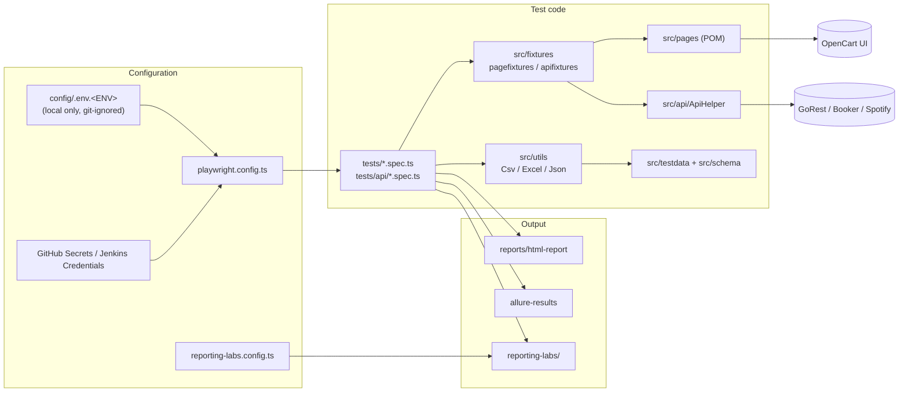
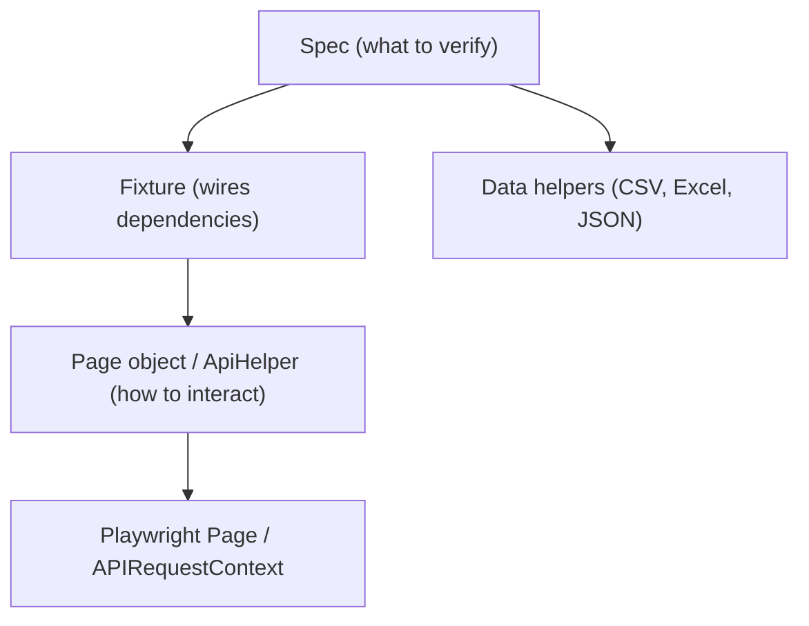
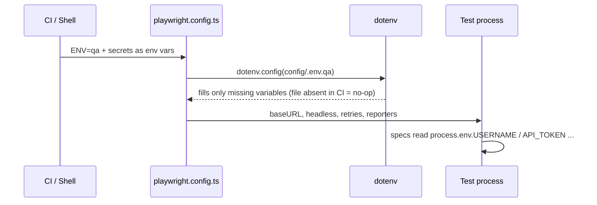
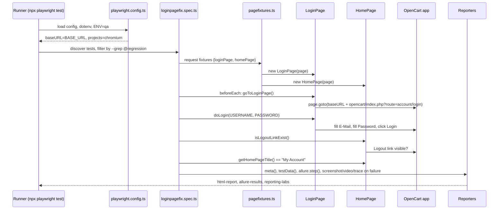
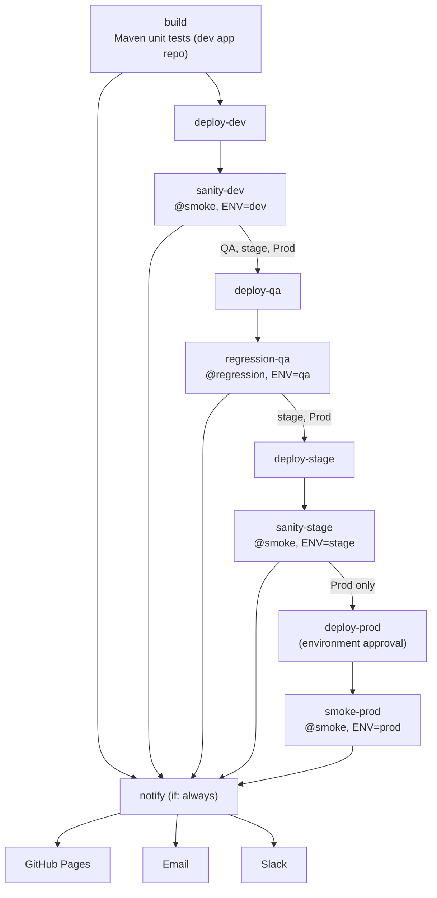
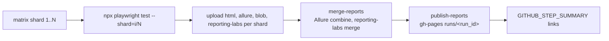
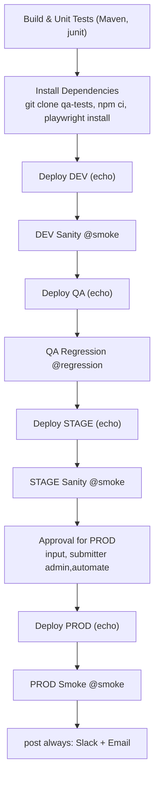
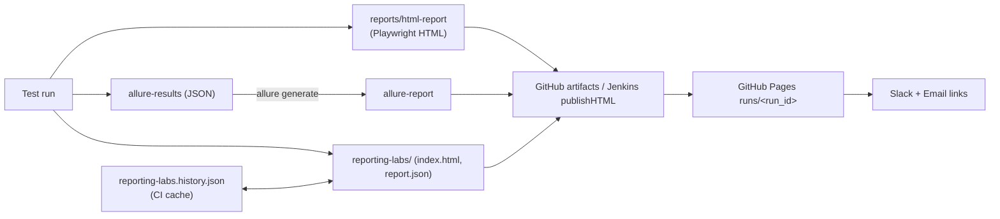

# Architecture

Playwright + TypeScript framework that automates UI (OpenCart) and API (GoRest, Restful-Booker, Spotify OAuth2) tests. It runs locally, in GitHub Actions and in Jenkins, publishes three reports and notifies through Slack and email.

## 1. High-level view

## 2. Directory responsibilities

| Path | Role | Key points |
|------|------|------------|
| [playwright.config.ts](playwright.config.ts) | Runner entry point | Loads `config/.env.<ENV>`, sets `baseURL`, headless/retries/workers by `CI`, reporters, `chromium` project |
| [reporting-labs.config.ts](reporting-labs.config.ts) | Reporting Labs options | Title, logo, `metadata.env` from `TEST_ENV`, run history file, Jira-style link templates |
| [config/](config) | Environment variables | Only `.env.example` is committed; `.env.dev/.qa/.stage` are git-ignored ([.gitignore](.gitignore)) |
| [src/pages/](src/pages) | Page Object Model | `BasePage` holds common locators/actions (logo, search, cart, footer, title); `LoginPage`, `HomePage`, `SearchResultsPage`, `ProductInfoPage`, `RegisterPage` extend it |
| [src/fixtures/](src/fixtures) | Dependency injection | `pagefixtures.ts` injects page objects and `testData` (CSV); `apifixtures.ts` injects `apiHelper` built from `API_BASE_URL` |
| [src/api/ApiHelper.ts](src/api/ApiHelper.ts) | HTTP wrapper | `get/post/put/delete` over `APIRequestContext`; returns `{ status, body }` |
| [src/utils/](src/utils) | Data readers | `CsvHelper` (csv-parse), `ExcelHelper` (xlsx), `JsonHelper` |
| [src/testdata/](src/testdata) | Data-driven inputs | `logindata.csv/json`, `product.csv`, `opencarttestdata.xlsx` |
| [src/schema/](src/schema) | JSON Schema | `userschema.json` validated with Ajv in API schema tests |
| [tests/](tests) | UI specs | `*fix.spec.ts`, `productpage`, `searchpage` use fixtures; `homepage`/`loginpage` are legacy (skipped) |
| [tests/api/](tests/api) | API + network specs | GoRest CRUD, schema, Restful-Booker, Spotify OAuth2, `page.route` interception/mocking |
| [.github/workflows/](.github/workflows) | GitHub Actions | `e2e.yml`, `master.yml`, `playwright.yml`, `sharded-tests.yml` |
| [Jenkinsfile](Jenkinsfile) | Jenkins pipeline | Multi-environment pipeline with Slack and email notification |

### Layering rule

Specs contain assertions only. Locators live in page classes (private `Locator` fields, public action methods). Fixtures create objects per test, so each test gets an isolated `page`.

## 3. Configuration: where values come from

There are no `.properties` files. All settings are environment variables, resolved in this order of precedence:

1. Variables already present in the process (GitHub `env:` from `secrets`, Jenkins `withCredentials` + inline `ENV=... npx playwright test`, or an exported shell variable).
2. `config/.env.<ENV>` loaded by `dotenv` in [playwright.config.ts](playwright.config.ts#L8-L10). `dotenv` does not override variables that already exist, so CI values win.
3. Defaults in code: `ENV` defaults to `qa`.

| Variable | Used by | Purpose |
|----------|---------|---------|
| `ENV` | `playwright.config.ts` | Selects `config/.env.<ENV>` (`dev`, `qa`, `stage`, `prod`) |
| `BASE_URL` | `use.baseURL` | UI root; `LoginPage.goToLoginPage()` navigates to the relative path `opencart/index.php?route=account/login` |
| `USERNAME`, `PASSWORD` | UI specs | Valid application login |
| `API_BASE_URL` | `apifixtures.ts` | Base URL for `ApiHelper` |
| `API_TOKEN` | `tests/api/*` | `Authorization: Bearer` for GoRest |
| `OAUTH_CLIENT_ID`, `OAUTH_CLIENT_SECRET`, `GRANT_TYPE` | `spotify.oauth2.spec.ts` | Client-credentials flow |
| `CI` | `playwright.config.ts` | Headless, 2 workers, 2 retries, `forbidOnly` (set automatically by GitHub Actions and Jenkins) |
| `TEST_ENV` | `reporting-labs.config.ts` | "env" chip in the report header (set in `sharded-tests.yml`; falls back to `local`) |
| `SLACK_WEBHOOK_URL`, `EMAIL_USERNAME`, `EMAIL_PASSWORD` | `e2e.yml` notify job | Slack and SMTP |

Config load sequence:

## 4. Playwright configuration summary

| Setting | Local | CI (`CI` set) |
|---------|-------|---------------|
| Headless | `false` | `true` |
| Retries | 0 | 2 |
| Workers | default | 2 |
| `fullyParallel` | true | true |
| Trace / screenshot / video | `on-first-retry` / `only-on-failure` / `retain-on-failure` | same |
| Reporters | `list`, `html` -> `reports/html-report`, `allure-playwright` -> `allure-results`, `reporting-labs` -> `reporting-labs/` | same |

Test selection is done with tags in test titles: `@smoke`, `@regression`, run via `--grep`.

## 5. End-to-end test walkthrough

Test: *"@regression user is able to login to app with valid credentials"* in [tests/loginpagefix.spec.ts](tests/loginpagefix.spec.ts).

Step by step:

1. `ENV=qa npx playwright test --project=chromium --grep @regression` starts the runner.
2. [playwright.config.ts](playwright.config.ts) loads `config/.env.qa` (or CI secrets) and sets `baseURL`.
3. The spec imports `test` from `src/fixtures/pagefixtures`, not from `@playwright/test`, so `loginPage` and `homePage` are injected.
4. `beforeEach` calls `loginPage.goToLoginPage()`; the relative path resolves against `BASE_URL`.
5. The test reads `process.env.USERNAME` / `PASSWORD`, calls `loginPage.doLogin(...)`, then asserts with `homePage` (`isLogoutLinkExist()`, `getHomePageTitle()` = `My Account`).
6. `meta({...})` and `testData(...)` from `reporting-labs` and `allure.step/feature/story` add metadata to the reports.
7. On completion, reporters write `reports/html-report/`, `allure-results/` and `reporting-labs/`; `reporting-labs.history.json` is updated for trend and flaky detection.

### API example

[tests/api/user.api.schema.spec.ts](tests/api/user.api.schema.spec.ts): the spec imports `test` from `apifixtures`, which creates `ApiHelper(request, API_BASE_URL)`. The test posts a user with `Authorization: Bearer ${API_TOKEN}`, then `GET`s it and validates the body against `src/schema/userschema.json` using Ajv.

### Data-driven example

`CsvHelper.readCsv('src/testdata/logindata.csv')` runs at module load; a `for` loop generates one `test(...)` per row (the same pattern applies to `ExcelHelper` and `JsonHelper`). The `testData` fixture exposes the CSV rows to a single test as an alternative.

## 6. CI/CD

### 6.1 Workflows overview

| Workflow | Trigger | Purpose |
|----------|---------|---------|
| [e2e.yml](.github/workflows/e2e.yml) | `workflow_dispatch` (input `environment`: dev, QA, stage, Prod) | Full promotion pipeline with reports, GitHub Pages, email and Slack |
| [master.yml](.github/workflows/master.yml) | `workflow_dispatch` (DEV, QA, STAGE, PROD) | Earlier variant of the same pipeline; targets another repo and uses upper-case option values |
| [playwright.yml](.github/workflows/playwright.yml) | `workflow_dispatch` (QA, STAGE, DEV); schedule/push/PR are commented out | Single-environment run of the whole suite |
| [sharded-tests.yml](.github/workflows/sharded-tests.yml) | `workflow_dispatch` (2 or 4 shards) | Parallel shards on QA, merged reports, published to GitHub Pages |

### 6.2 `e2e.yml` pipeline ("run up to environment")

How each test job gets its configuration:

- `environment: dev | QA | stage | Prod` binds the job to a GitHub Environment (secrets, protection rules, required reviewers for Prod).
- The `env:` block of the test step maps `secrets.*` to `BASE_URL`, `USERNAME`, `PASSWORD`, `API_BASE_URL`, `API_TOKEN`, `OAUTH_*`, `GRANT_TYPE`, and sets `ENV`. No `.env.<ENV>` file exists on the runner, so `dotenv` is a no-op and the secrets are used as-is.
- `actions/cache` keeps `~/.cache/ms-playwright` (keyed by `package-lock.json`) and `reporting-labs.history.json` (keyed per environment) so the trend chart survives between runs.
- After the tests, `if: always()` steps generate the Allure report and upload three artifacts per stage: HTML, Allure and Reporting Labs.

Notify job:

1. Maps each job's `needs.<job>.result` to an emoji (success, skipped, failed) and computes an overall status; skipped stages do not count as failures.
2. Downloads all artifacts, builds `pages-deploy/runs/<run_id>/` with an `index.html` landing page and per-stage folders (`dev-html`, `qa-allure`, `stage-rlabs`, ...).
3. `peaceiris/actions-gh-pages@v4` publishes it to GitHub Pages (`keep_files: true` retains earlier runs).
4. `dawidd6/action-send-mail@v3` sends an HTML dashboard via SMTP using `EMAIL_USERNAME` / `EMAIL_PASSWORD`.
5. `8398a7/action-slack@v3` posts a Block Kit message (overall status, branch, actor, per-stage status, buttons to the report and the Actions run) to the webhook in `SLACK_WEBHOOK_URL`.

### 6.3 `playwright.yml`

Single job. The environment comes from `github.event.inputs.environment` (default `QA`) and is used for the GitHub Environment, `ENV`, and the history cache key. Runs `npx playwright test --project=chromium` and uploads the HTML, Allure results and Reporting Labs artifacts.

### 6.4 `sharded-tests.yml`

`publish-reports` writes to the same `gh-pages` branch as `e2e.yml`; the shared `concurrency.group: gh-pages` serializes pushes. No Slack/email step exists in this workflow.

### 6.5 Jenkins ([Jenkinsfile](Jenkinsfile))

- Tooling comes from Jenkins Global Tool Configuration: `nodeJS24`, `maven`, `jdk25`, `Allure`.
- Parameters `ENVIRONMENT`, `BROWSER`, `TEST_SUITE` are declared; currently only `ENVIRONMENT` is used (in the notification). Each stage hard-codes its `ENV` and `--grep` tag.
- Secrets are read with `withCredentials` from Jenkins credential IDs: `<env>-credentials` (username/password), `<env>-base-url`, `api-base-url`, `api-token`, `oauth-client-id`, `oauth-client-secret`. They are passed inline (`ENV=dev BASE_URL=$BASE_URL ... npx playwright test`), so `dotenv` is again a no-op.
- `GRANT_TYPE=client_credentials` is hard-coded.
- Each test stage copies reports to `reports-<env>/{html,allure,reportinglabs}` and publishes them with `publishHTML` (3 reports x 4 environments = 12).
- Options: 30-minute timeout, timestamps, keep 20 builds, no concurrent builds.
- Final `post { always }`:
  - Slack: `slackSend(channel: env.SLACK_CHANNEL ('#general'), color, message)` with status, environment, build number, duration, and links to the build and console. It uses the Jenkins Slack plugin and the workspace/token configured in Jenkins (Manage Jenkins > System > Slack), not a file in this repo.
  - Email: `emailext` HTML to the configured recipient, using the Jenkins Email Extension plugin SMTP settings.

### 6.6 Comparison

| Aspect | GitHub Actions | Jenkins |
|--------|----------------|---------|
| Config source | `secrets.*` per GitHub Environment | Credentials store IDs |
| Environment selection | `workflow_dispatch` input, jobs gated with `if: contains(...)` | Linear stages, no gating by `ENVIRONMENT` |
| Prod gate | GitHub Environment protection rules | `input` step with submitters |
| Report hosting | Artifacts + GitHub Pages (`runs/<run_id>`) | `publishHTML` on the build page |
| Slack | `8398a7/action-slack` + `SLACK_WEBHOOK_URL` | `slackSend` + plugin config |
| Email | `dawidd6/action-send-mail` (SMTP secrets) | `emailext` |
| Sharding | `sharded-tests.yml` matrix | Not used |

## 7. Reporting flow

- Playwright HTML: native report with traces, screenshots and videos.
- Allure: built from `allure-results` using `allure-commandline`; suites/steps come from `allure.*` calls in specs.
- Reporting Labs: reads `meta({ priority, severity, owner, story, epic, feature, issue })`, `log()` and `testData()`; `links` in `reporting-labs.config.ts` turn `story/epic/issue` into Jira-style URLs; `open: 'always'` never opens a browser in CI.

## 8. Observations

- `config/.env.dev|qa|stage` are intentionally untracked; create them from `config/.env.example` for local runs.
- The Playwright config has no `blob` reporter, while `sharded-tests.yml` uploads `blob-report/` and the merge job runs `playwright merge-reports ./all-blob-reports`. Add `['blob']` to the CI reporters for that merge step to have input.
- `e2e.yml` and `master.yml` check out different `repository:` values, and `master.yml` offers upper-case environment options (`DEV`, `QA`, ...). Locally, `ENV` must match the lowercase `config/.env.<ENV>` file name.
- `reporting-labs.config.ts` reads `TEST_ENV`, which only `sharded-tests.yml` sets; other pipelines display `local`.
- Jenkins parameters `BROWSER` and `TEST_SUITE` are not wired into the commands.
