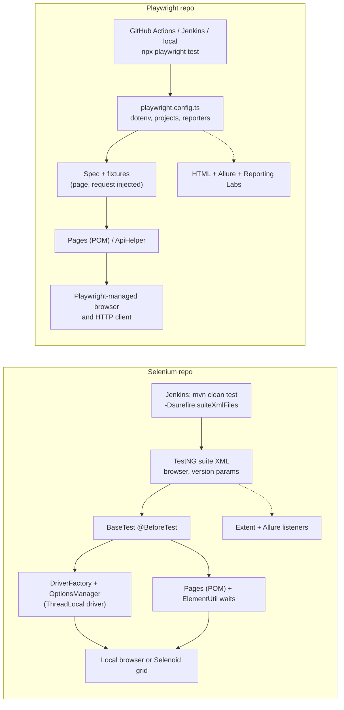

# Selenium vs Playwright

Comparison of the two frameworks in this workspace, both automating the same OpenCart demo application:

| | Selenium repo | Playwright repo |
|---|---|---|
| Folder | `SeleniumWebDriverPOMCICD` | `PlaywrightUIAPIGitHubActions` |
| Architecture doc | [POM_ARCHITECTURE.md](../SeleniumWebDriverPOMCICD%20copy/POM_ARCHITECTURE.md) | [PlaywrightArchitecture.md](PlaywrightArchitecture.md) |
| Scope | UI only | UI + API + network mocking |

## 1. Tech stack

| Category | Selenium repo | Playwright repo |
|----------|---------------|-----------------|
| Language | Java 11 | TypeScript (ES modules) |
| Automation library | Selenium WebDriver 4.21.0 | `@playwright/test` ^1.64 |
| Test runner | TestNG 7.7.0 (suite XMLs, `@DataProvider`, listeners) | Playwright Test (built in; fixtures, projects, `--grep`) |
| Build / dependency tool | Maven (`pom.xml`, surefire 2.20, assembly plugin) | npm (`package.json`, `npm ci`) |
| Browser handling | Local drivers via `DriverFactory` / `OptionsManager`, or remote Selenoid grid in Docker | Playwright-managed browsers (`npx playwright install chromium`) |
| Parallelism | TestNG `parallel="tests"` with 4 threads, surefire `forkCount=3`, `ThreadLocal<WebDriver>` | `fullyParallel`, workers (2 in CI), sharding (`--shard=i/N`) |
| Waiting | Explicit waits wrapped in `ElementUtil` (`WebDriverWait`) | Built-in auto-waiting on actions and web-first assertions |
| Page abstraction | POM with `By` locators; page actions return the next page object | POM extending `BasePage` with `Locator` fields, injected through fixtures |
| Locators | `By.id`, `By.xpath`, `By.linkText` | `getByRole`, `locator(css)` |
| API testing | Not present | `APIRequestContext` via `ApiHelper`, Ajv schema validation, OAuth2 |
| Network interception | Not present | `page.route` logging and mocking (fake JSON / HTML) |
| Test data | Apache POI (Excel), OpenCSV, `@DataProvider` | `csv-parse`, `xlsx`, JSON; loop-generated tests and fixtures |
| Assertions | TestNG `Assert` and `SoftAssert` | Playwright `expect` (with auto-retry) and `expect.soft` |
| Reporting | Extent Reports 5.0.8, Allure (`allure-testng`, AspectJ weaver) | Playwright HTML, Allure (`allure-playwright`), `reporting-labs` |
| Retry | `Retry` analyzer + `AnnotationTransformer` | `retries` in config (2 in CI) |
| Failure artifacts | Screenshots from listeners | Screenshot, video and trace configured in `playwright.config.ts` |
| Configuration | `.properties` per environment (`qa`, `dev`, `stage`, `uat`, `config`) selected by `-Denv` | `.env.<ENV>` (git-ignored) via `dotenv`, plus CI secrets as env vars |
| Grid / infrastructure | Selenoid + Selenoid UI via `docker-compose.yml`, `browsers.json` | None needed; Playwright runs browsers directly |
| CI/CD | Jenkins only (`Jenkinsfile`) | GitHub Actions (4 workflows) and Jenkins |
| Notifications | None in the pipeline | Slack and email (GitHub Actions and Jenkins) |
| Report hosting | Jenkins `publishHTML` / Allure plugin | Artifacts, GitHub Pages (`runs/<run_id>`), Jenkins `publishHTML` |
| Other libraries | Lombok, AspectJ | Ajv |

## 2. Side-by-side architecture



| Concern | Selenium repo | Playwright repo |
|---------|---------------|-----------------|
| Test setup | Inheritance: tests `extend BaseTest`, which creates the driver and pages in `@BeforeTest` | Composition: fixtures create `page` and page objects per test |
| Browser lifecycle | Per `<test>` tag (`@BeforeTest` / `@AfterTest`), so tests in one class share a browser | Fresh isolated browser context per test |
| Driver management | Hand-written factory, options manager, `ThreadLocal` | Provided by the framework |
| Waits | Written by hand in utility classes | Built in |
| Environment selection | `-Denv=qa` picks a properties file; suite XML params override browser | `ENV=qa` picks `.env.qa`; real env vars override the file |
| Suite selection | Separate XML files (`test_regression.xml`, `test_sanity.xml`) | Tags in titles (`@smoke`, `@regression`) with `--grep` |
| Cross-browser | Chrome, Firefox, Edge, Safari (local); versions via Selenoid | Chromium, Firefox, WebKit (only `chromium` is enabled in config) |
| Scale-out | Selenoid grid + TestNG threads | Workers + CI shards (matrix) |

## 3. Same scenario, two implementations

Login with valid credentials:

Selenium (Java, TestNG):

```java
@Test(priority = 4)
public void loginTest() {
    accPage = loginPage.doLogin(prop.getProperty("username"), prop.getProperty("password"));
    Assert.assertEquals(accPage.getAccPageTitle(), AppConstants.ACCOUNTS_PAGE_TITLE, AppError.TITLE_NOT_FOUND);
}
```

Playwright (TypeScript):

```ts
test('@regression user is able to login to app with valid credentials', async ({ loginPage, homePage }) => {
    await loginPage.doLogin(process.env.USERNAME!, process.env.PASSWORD!);
    expect.soft(await homePage.isLogoutLinkExist()).toBeTruthy();
    expect.soft(await homePage.getHomePageTitle()).toBe('My Account');
});
```

Differences visible in the code:
- Selenium needs `BaseTest`, `DriverFactory`, `ElementUtil` and `TimeUtil` to get a driver and handle waits; Playwright gets the page from a fixture and waits automatically.
- Selenium uses `priority` to order tests; Playwright tests are meant to be independent and run in parallel.
- Selenium credentials come from `prop.getProperty(...)` (a properties file); Playwright reads `process.env`.

## 4. CI/CD comparison

| Aspect | Selenium repo | Playwright repo |
|--------|---------------|-----------------|
| Pipeline | Jenkins: build, deploy Dev/QA (placeholders), regression, Allure, deploy Stage (placeholder), sanity, Extent | Jenkins and GitHub Actions: Dev sanity, QA regression, Stage sanity, Prod smoke with approval gate |
| Env promotion | Linear, no env passed to Maven (always QA) | "Run up to environment" input; each stage runs with its own `ENV` and secrets |
| Secrets | Properties files in the repo (credentials in plain text) | GitHub Secrets / Jenkins credentials injected as env vars; `.env.*` git-ignored |
| Failure handling | `catchError(buildResult: 'SUCCESS', stageResult: 'FAILURE')`: build stays green | Failures fail the job; notify job reports each stage |
| Reports | Allure plugin + Extent HTML | 3 reports per stage, merged for shards, hosted on GitHub Pages |
| Notifications | None | Slack (`slackSend` / `action-slack`) and email |
| Browser infra | Needs a local browser or a running Selenoid grid | `npx playwright install --with-deps chromium` on the runner, cached |
| Caching | Maven cache only | Node, Playwright browsers and Reporting Labs history cached |

## 5. Pros and cons

### Selenium (Java + TestNG)

Pros:
- Mature, with the widest language support (Java, Python, C#, JavaScript, Ruby, Kotlin) and a very large community and hiring pool.
- W3C WebDriver standard; works with real branded browsers, older browsers and Safari on Mac.
- Large ecosystem: Selenium Grid, Selenoid, Appium (mobile), cloud vendors (BrowserStack, Sauce Labs, LambdaTest), TestNG/JUnit, Maven/Gradle.
- Fits teams and applications already on the Java stack, with existing enterprise tooling (Maven, Nexus, Jenkins).
- Easy to integrate with existing Java libraries (JDBC, POI, REST Assured).
- Gives complete control over driver setup and architecture.

Cons:
- More boilerplate: driver factory, options manager, wait utilities, listeners, `ThreadLocal` handling (about 28 Java files in this repo for UI only).
- No auto-waiting; flakiness depends on correct explicit waits.
- Out-of-process WebDriver protocol is slower and less reliable than Playwright's direct browser protocol.
- Browser-level features (network mocking, tracing, video, geolocation, multiple contexts) need extra tools or are missing.
- No built-in API testing; needs another library.
- Parallel runs need thread-safe design and grid infrastructure (Docker, Selenoid, `browsers.json` maintenance).
- Reporting, retries, screenshots and trace-like debugging are all hand-built.

### Playwright (TypeScript)

Pros:
- Auto-waiting and web-first assertions reduce flakiness and code.
- Single package includes runner, assertions, fixtures, parallelism, sharding, retries, tracing, screenshots and video.
- Isolated browser contexts per test: fast, parallel-safe and cheap.
- Built-in API testing and network interception (`page.route`) allow UI + API in one framework (about 13 spec files here cover both).
- Trace Viewer, codegen and UI mode speed up debugging and authoring.
- Chromium, Firefox and WebKit with one API; simple CI (`npx playwright install`) with no driver or grid setup.
- Strong CI story: sharding, blob report merging, GitHub Actions friendliness.
- Less code for the same coverage (fixtures replace the base class and driver factory).

Cons:
- Younger ecosystem; fewer experienced engineers and fewer legacy integrations.
- Language support: TypeScript/JavaScript, Python, Java and .NET are supported, but the TypeScript version is the most complete.
- Uses patched browser builds rather than real branded browsers (Chrome/Edge channels are available, Safari is only approximated by WebKit).
- No native mobile app automation (only mobile browser emulation); Appium is still required for apps.
- Not suitable for very old browsers (e.g. legacy IE).
- Cloud grid support exists but is less standardised than Selenium Grid; it depends on vendor support.
- Existing Java/Selenium suites need a rewrite, not a drop-in swap.
- Test code is async/await based, which is a learning curve for Java-only teams.

## 6. Which framework fits which project

| Project type / situation | Better fit | Why |
|--------------------------|-----------|-----|
| New web application test automation | Playwright | Faster setup, less flakiness, rich tooling |
| Modern SPA (React, Angular, Vue) with dynamic content | Playwright | Auto-waiting and web-first assertions |
| UI + API tests in one repo | Playwright | Built-in `request` context and schema validation |
| Need to mock or intercept network calls | Playwright | `page.route` |
| Fast CI feedback with sharding | Playwright | Sharding and report merge out of the box |
| Existing large Java/TestNG automation suite | Selenium | Preserves investment; incremental improvement |
| Team is Java-only, with Maven/Nexus/Jenkins standards | Selenium (or Playwright for Java) | Matches skills and tooling |
| Real Safari, legacy or unusual browsers | Selenium | Real browser drivers and broad vendor support |
| Mobile native app testing | Selenium + Appium | Playwright does not automate native apps |
| Enterprise with vendor grids (BrowserStack, Sauce Labs) | Selenium | Longest-standing support |
| Regulated environments requiring W3C standard and long-term stability | Selenium | Standardised protocol |
| Small team, limited framework-building time | Playwright | Much less infrastructure code |
| Visual/debug-heavy work (flaky failures, trace inspection) | Playwright | Trace Viewer, video, screenshots |

Rule of thumb: choose Playwright for new web projects and for UI+API coverage; keep Selenium where there is a large Java investment, a need for real-browser or Safari coverage, or Appium-based mobile testing.

## 7. Observations on the two repos

Selenium repo:
- `qa.properties` is the only environment file with `huburl`; `dev`, `stage`, `uat` and `config` set `remote=true` without it, so remote mode would fail there.
- `browsers.json` repeats the `versions` key per browser; JSON parsers keep only the last one.
- `Jenkinsfile` does not pass `-Denv`, so it always runs QA with `remote=false`; the sanity stage runs `mvn clean`, which removes the regression `allure-results`.
- `pom.xml` contains a Nexus URL with embedded credentials (`distributionManagement`); move it to `settings.xml` / Jenkins credentials and rotate the password.
- Credentials live in properties files in the repo (see the security note in the POM architecture doc).
- Legacy `testng.xml` references classes that no longer exist.
- Old Apache POI 3.9 artifacts are used; newer versions are recommended.

Playwright repo:
- The config has no `blob` reporter, but `sharded-tests.yml` merges blob reports.
- Jenkins parameters `BROWSER` and `TEST_SUITE` are declared but not used.
- `TEST_ENV` (report header) is only set by the sharded workflow.
- Only the `chromium` project is enabled; Firefox and WebKit are commented out.
- Legacy specs (`homepage.spec.ts`, `loginpage.spec.ts`) are skipped.

## 8. Summary

| Dimension | Selenium repo | Playwright repo |
|-----------|---------------|-----------------|
| Coverage | UI | UI + API + network mocking |
| Framework code to maintain | High (factory, utils, listeners) | Low (config + fixtures) |
| Flakiness risk | Depends on explicit waits | Lower (auto-wait) |
| Infrastructure | Selenoid/Docker or local drivers | None beyond browser install |
| CI maturity | Basic Jenkins pipeline | Multi-env pipelines, sharding, Pages, Slack, email |
| Security of config | Credentials in repo | Secrets via CI, `.env` ignored |
| Best fit | Java shops, legacy/enterprise, mobile via Appium | New web/API projects, fast feedback, modern stacks |
